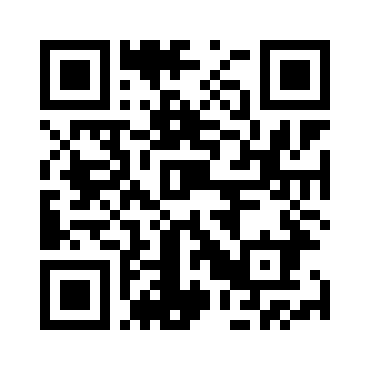

# lectern

Every talk, captioned, in your hand.

Note:
I'm a parent of two deaf children. I've seen firsthand how miserable and inaccessible experiences like conferences can be for people with disabilities. It's a wall of sound. So I built lectern.

---

## My two daughters are deaf

A conference talk is a wall of sound.

- Captions are rare, and usually only on the main stage
- Interpreters are booked for a keynote, not track 3
- Slides alone tell half the story

Note:
Here's how it works for the audience. You scan the QR code on the screen. No app, no account. On your phone you get the current slide and live captions of what I'm saying right now. You can see them appearing on the right as I talk.

---

## Scan. Read along. That's it.

- **Live captions** on your own phone, as the speaker talks
- **The current slide**, as shown or as large text
- **Your settings**: caption size, high contrast, screen reader
- **Scroll back** and **save the transcript**

Note:
Every attendee picks their own settings.

[Phone: Aa → XL → High contrast → Done]

Bigger captions, high contrast. You can switch the slide to large text for low vision or a screen reader. Scroll back if you missed something, jump back to live, and save the whole transcript after the talk.

---

## The curb cut effect

Built for deaf and hard-of-hearing attendees. Useful for everyone:

- The back row, and anyone who can't see the screen
- Non-native speakers who read faster than they listen
- Anyone taking notes, or who stepped out for a minute
- The speaker, who gets a transcript for free

Note:
This is the curb cut effect. Curb cuts were built for wheelchairs, and now everyone with a stroller uses them. lectern was built for deaf attendees, but it helps the back row, non-native speakers, note-takers, anyone who stepped out. And my camera is on the slides, which helps people who read lips.

[Press C]

The speaker can put captions on the projector for the whole room too.

---

## How it works

- Runs on the speaker's laptop. No cloud service, no accounts, no app to install
- Captions come from the laptop mic, on-device where Chrome supports it
- Every caption saved to **Elasticsearch**, timestamped against the recording: search any talk, jump to the moment
- Phones get a **read-only** page: speaker notes never leave the laptop
- Phones can't skip ahead of the speaker
- Any Markdown deck: `./present.sh init my-talk`

Note:
Every caption is saved to Elasticsearch, timestamped against the recording. After the talk you can search anything that was said and jump straight to that moment, with captions. And search understands speech-recognition mistakes, like 'elastic search' as two words. It all runs on the speaker's laptop. Phones connect to a read-only page, and speaker notes never leave the laptop.

[Press → twice: skip slide 6]

---

## Built today on yesterday's presenter

- **Before:** a two-window presenter I wrote for my ArgoCon talk
- **Today:** any deck, live captions, phone follow-along, QR join, accessibility settings, Elasticsearch archive, recording
- Built with Claude Code, disclosed in the README

Note:
[Skip this slide: press →]

---

## Try it now

Scan for the code

github.com/ dirtmerchant/ lectern

Open source · MIT

Note:
It's open source. Scan the code to grab it. Built today at the Cloud Native Hackathon. Thanks.

[Stop recording]
